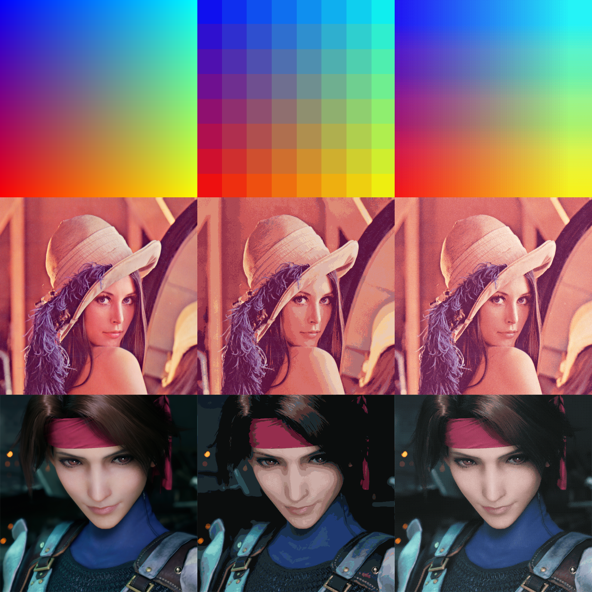

## Color Reduction

Reduce color information (quantization) of a 24-bit RGB bitmap down to 8-bit palette-based bitmap.

This project includes three color quantization tools:
- **octree**: Octree color quantization with k-d tree accelerated palette mapping
- **unipal**: Uniform palette quantization (8:8:4 RGB) with k-d tree remapping
- **colormatch**: Standalone tool for mapping any image to any palette using k-d tree

### Compile

```
make
```

or 

```
mingw32-make	# for MinGW32/64 users
```

or 

```
makedos.bat		# MS-DOS target
```

No external dependencies required. It was tested on **macOS Monterey** (clang) **Windows 10** (LLVM MinGW64) and **MS-DOS** (DJGPP).

### Usage

#### Uniform Palette (unipal)

```
./unipal input.bmp [output.bmp] [-d[ither]]
```

Whereas:

* `input.bmp`: image to be quantized, must be a 24-bit Windows bitmap.
* `output.bmp`: name of the file to store the output image.
* `-d[N]`, `-dither[N]`: enable dithering using 4x4 ordered matrix with strength N (1-9)

If not specified, the output image will be stored as a 8-bit Windows bitmap under the default name `output.bmp`.

#### Octree Quantization (octree)

```
./octree input.bmp output.bmp [max_colors] [-d[N]]
```

Whereas:

* `input.bmp`: 24-bit input image
* `output.bmp`: 8-bit output image
* `max_colors`: target number of colors (2-256, default: 256)
* `-d[N]`: optional dithering with strength N (1-9)

See [OCTREE.md](OCTREE.md) for implementation details.

#### Color Matcher (colormatch)

```
./colormatch input.bmp palette.bmp output.bmp [-d[N]]
```

Whereas:

* `input.bmp`: 24-bit input image to remap
* `palette.bmp`: 8-bit indexed image providing the palette
* `output.bmp`: 8-bit output image
* `-d[N]`: optional dithering with strength N (1-9)

This tool uses k-d tree for O(log n) nearest color lookup, making it suitable for large palettes.

### Features

- **k-d tree acceleration**: All tools use k-d trees for fast nearest color lookup in RGB space
- **Shared libraries**: Common functionality (image I/O, dithering, k-d tree) in reusable modules
- **Bayer matrix dithering**: 4x4 ordered dithering with adjustable strength
- **Optimized octree**: Build-then-reduce strategy for better performance

### Preview

**Left**: Original; **Middle**: 8-bit undithered; **Right** 8-bit dithered.


